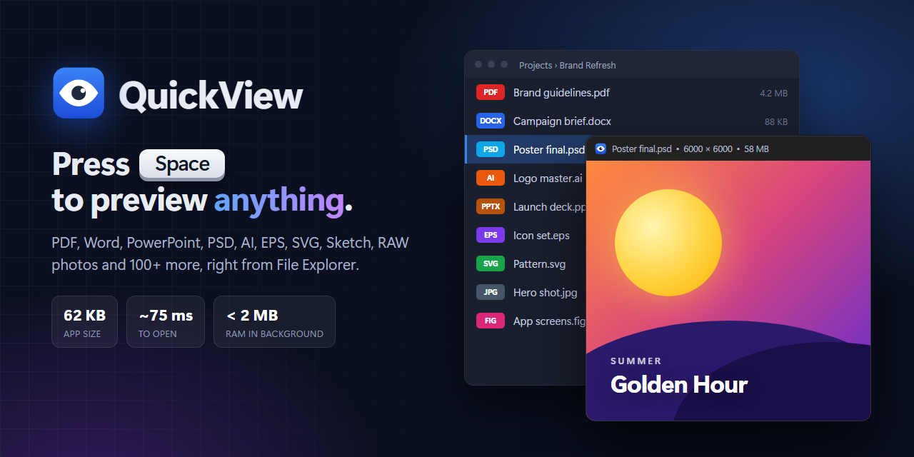

  

  

  <a href="https://abdullah-al-faahim.github.io/QuickView-Windows/"><b>Website</b></a> &nbsp;·&nbsp;
  <a href="https://github.com/abdullah-al-faahim/QuickView-Windows/releases"><b>All releases</b></a> &nbsp;·&nbsp;
  <a href="https://github.com/abdullah-al-faahim/QuickView-Windows/issues"><b>Report an issue</b></a>
    
  
  
  
  

---

**QuickView** brings Space-to-preview to Windows. Select any file in File Explorer or on the desktop, tap **Space**, and the preview appears in about 75 ms. Tap Space again to close it.

- ⚡ **Fast and tiny.** One 62 KB file with no runtime and no frameworks. It uses under 2 MB of RAM and 0% CPU while waiting.
- 🎨 **Built for designers.** Previews PSD, PSB, AI, EPS, INDD, SVG, Sketch, Adobe XD, Figma, Krita and Procreate files, no Adobe apps required.
- 📄 **Every document.** PDF, Word, Excel, PowerPoint, Visio, Outlook mail and HTML through Windows' own preview handlers.
- 🖼️ **Photos done right.** JPG, PNG, WEBP, HEIC, AVIF, TIFF and camera RAW, rendered on the GPU with zoom, pan and EXIF rotation.
- ⌨️ **Keyboard first.** <kbd>←</kbd> <kbd>→</kbd> to browse the folder, <kbd>Enter</kbd> to open, <kbd>Space</kbd> or <kbd>Esc</kbd> to close.

## Install

**Option A: just run it**

1. Download **[QuickView.exe](https://github.com/abdullah-al-faahim/QuickView-Windows/releases/latest/download/QuickView.exe)** and run it. It lives in the system tray.
2. Right-click the tray icon and tick **Start with Windows**.

**Option B: installer ZIP** (installs per user and adds QuickView to *Open with*)

1. Download **[QuickView-1.0.0-win64.zip](https://github.com/abdullah-al-faahim/QuickView-Windows/releases/latest/download/QuickView-1.0.0-win64.zip)** and extract it.
2. Right-click `install.ps1` → **Run with PowerShell**. No admin rights needed.

> [!NOTE]
> QuickView isn't code-signed yet, so Windows SmartScreen may say *"Windows protected your PC"*. Click **More info → Run anyway**. The app makes no network connections and needs no admin rights.

## Supported formats

| Category | Formats |
|---|---|
| **Documents** | PDF, DOC/DOCX, XLS/XLSX, PPT/PPTX, RTF, VSDX, MSG, EML, HTML, ODT/ODS/ODP. Full rendering uses installed preview handlers (Office, Edge, LibreOffice…). Without Office, DOCX/XLSX/PPTX show their text. |
| **Design** | PSD, PSB, AI, AIT, EPS, INDD, SVG, SVGZ, Sketch, XD, Figma (.fig), Krita, OpenRaster, Procreate, 3MF |
| **Images** | JPG, PNG, GIF, BMP, TIFF, ICO, WEBP, HEIC/HEIF, AVIF, JXR, DDS, RAW (CR2, NEF, ARW, DNG…) |
| **Text & code** | TXT, MD, JSON, XML, CSV, LOG, YAML, INI and 100+ source-code extensions |
| **Everything else** | Archives show their contents, videos show a thumbnail, and any other file gets an info card |

## Keyboard & mouse

| Input | Action |
|---|---|
| <kbd>Space</kbd> | Open / close preview |
| <kbd>←</kbd> <kbd>→</kbd> | Previous / next file (Explorer's selection follows) |
| <kbd>Enter</kbd> | Open in the default app |
| <kbd>Esc</kbd> | Close |
| Mouse wheel · drag · double-click | Zoom · pan · reset (images and SVG) |

## Requirements

Windows 10 version 1703 or later, or Windows 11, 64-bit.

## Uninstall

Untick **Start with Windows** in the tray menu, choose **Exit**, and delete `QuickView.exe`. If you used the ZIP, run `uninstall.ps1` instead.

---

This repository hosts QuickView's releases and website. Found a bug or a format that doesn't preview? <a href="https://github.com/abdullah-al-faahim/QuickView-Windows/issues">Open an issue</a>.

